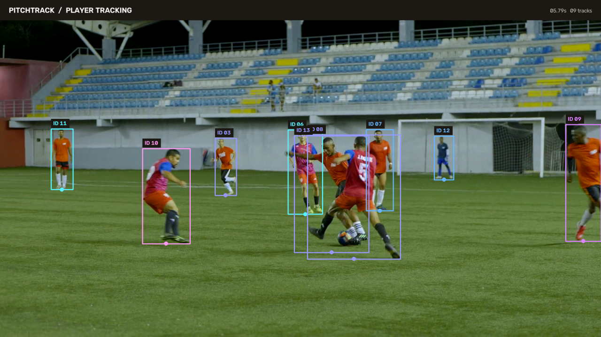
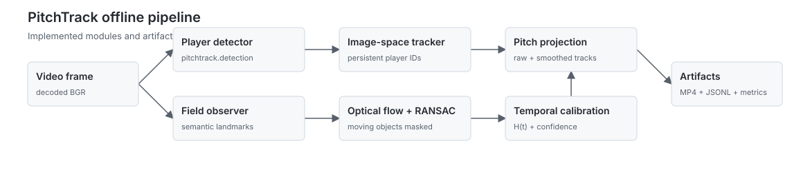

# PitchTrack

Offline football video analytics for a single continuous moving-camera shot.
PitchTrack maintains player IDs in image space, estimates a time-varying planar
homography, and emits pitch coordinates only while the geometry is defensible.

[](assets/tracking-showcase.gif)

*Real YOLO11n detections and PitchTrack image-space track IDs on a licensed,
continuous night-match clip. Click the frame to view the 4.6-second sequence.*



## Architecture

Pretrained models provide player detections and semantic field observations. PitchTrack
combines multi-object tracking with masked optical flow and RANSAC-based homography
estimation to maintain a time-varying planar field transform through a continuous
moving-camera shot.

Temporal calibration validates geometry frame by frame and reinitialises when needed.
Player tracks remain available in image space; pitch coordinates are omitted when geometry
is unreliable.

## Engineering focus

- **Dynamic calibration:** semantic field observations initialise and reinitialise
  `H(t)` while masked optical flow and RANSAC propagate camera motion frame to frame.
- **Stable image-space tracking:** player IDs survive short detection gaps and remain
  available when pitch geometry is unavailable.
- **Explicit uncertainty:** every frame is `valid`, `predicted`, or `invalid`. Invalid
  calibration produces `null` pitch coordinates rather than plausible-looking errors.

## Outputs

One offline run writes synchronized artifacts:

```text
output/
├── annotated.mp4
├── tracks.jsonl
├── calibration.jsonl
├── run_metadata.json
└── metrics.json
```

`tracks.jsonl` preserves raw and smoothed pitch coordinates. Smoothing state is reset
across invalid calibration so stale geometry cannot leak into a recovered track.

## Run the deterministic fixture

Python 3.11+ is required.

```powershell
python -m venv .venv
.\.venv\Scripts\python.exe -m pip install -e ".[dev,media]"
.\.venv\Scripts\python.exe -m pitchtrack demo-fixture `
  --out .tmp\fixture `
  --camera-pan-px-per-frame 1.5
.\.venv\Scripts\python.exe -m pitchtrack analyze `
  --video .tmp\fixture\input.mp4 `
  --config .tmp\fixture\config.yaml `
  --calibration-mode hybrid_temporal `
  --out outputs\fixture-run
.\.venv\Scripts\python.exe -m pytest -q
```

## Run with local models

PitchTrack never downloads weights at runtime. Acquire them under their upstream terms,
keep them in the ignored `weights/` directory, and use explicit paths:

```powershell
.\.venv\Scripts\python.exe -m pip install -e ".[models,media]"
Copy-Item configs\models.example.yaml configs\models.local.yaml
.\.venv\Scripts\python.exe -m pitchtrack analyze `
  --video data\input\continuous-shot.mp4 `
  --config configs\models.local.yaml `
  --calibration-mode hybrid_temporal `
  --out outputs\match-run
.\.venv\Scripts\python.exe -m pitchtrack make-assets `
  --run outputs\match-run `
  --out assets `
  --source-kind model
```

The field-model adapter contract is deliberately replaceable:
`image_points_px`, `pitch_points_m`, and `confidences`. Fine-tuned models can replace
baseline predictors without changing calibration or artifact code.

## Scope and limitations

- One continuous shot; broadcast cuts and replays are not handled in this release.
- Planar field homography, not full physical PTZ or 3D reconstruction.
- The built-in tracker uses deterministic IoU association with lost-track retention; it
  is not appearance/ReID tracking.
- Official benchmark scores are not claimed until the corresponding datasets and
  evaluators have been run.
- Live FPS, latency, and dropped-frame behavior are a later phase; current measurements
  describe offline processing only.

See [evaluation](docs/evaluation.md), [demo status](docs/demo.md), and
[licensing](docs/licensing.md). No command pushes, uploads, or downloads data automatically.
